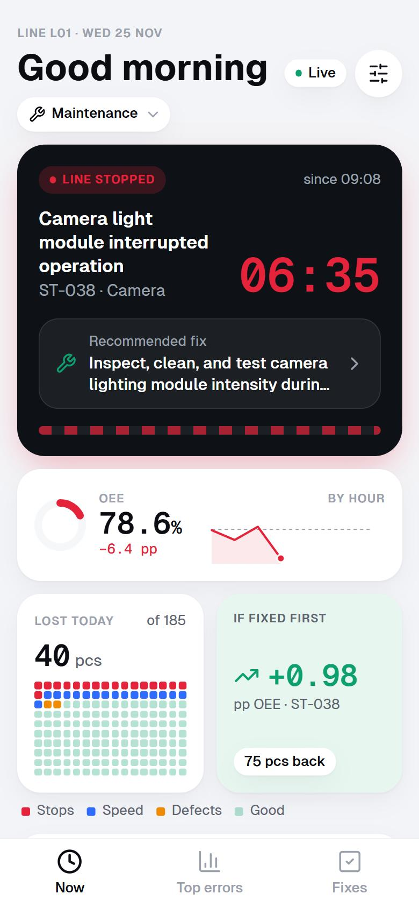
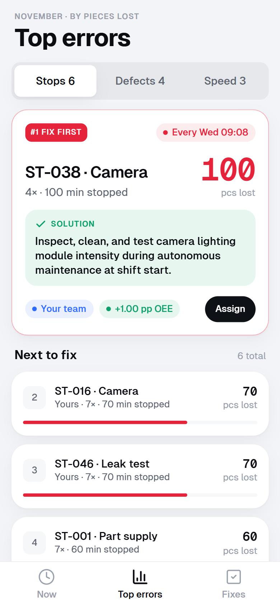
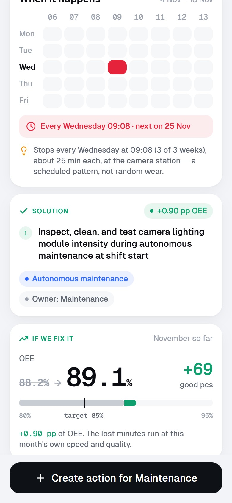
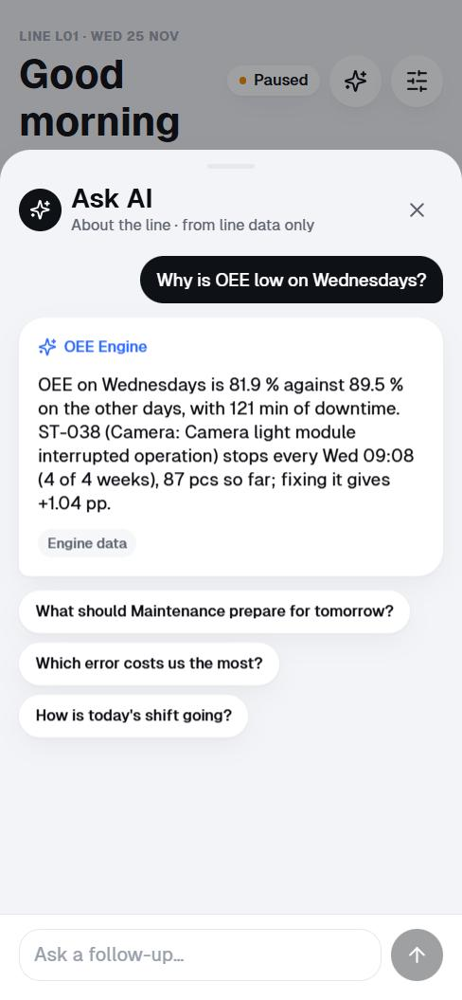
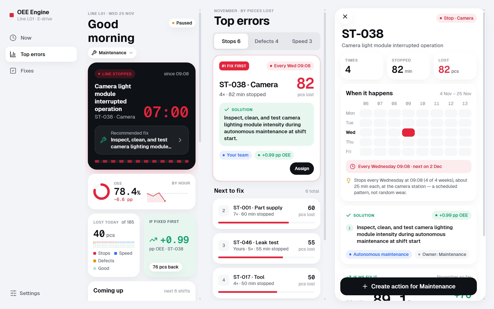

# OEE Engine — AI OEE Improvement Engine

**Every production loss visible and actionable — before the line stops.**

[](https://oee-engine.onrender.com/)


A phone-first app for an electric drive assembly line. It replays the line data in real time,
finds the losses that repeat, predicts the next stop, shows what fixing it is worth and who owns the
fix, and answers "why?" with an AI assistant that only uses the line data.

Built in a few days at **Magna Hackathon 2026** (challenge 5, "AI OEE Improvement Engine") by team
**ARVYDLiKuz** — see [Team](#team).

**Try it:** [oee-engine.onrender.com](https://oee-engine.onrender.com/) — pick a role, then
*Settings → Start demo*. It runs on a free server, so the first load can take up to a minute.
**Pitch deck:** [PDF](docs/pitch/pitch_deck.pdf) · [PPTX](docs/pitch/pitch_deck.pptx)

<p>
  
  
  
  
</p>



## What the data shows

One line, 21 shifts. Monthly OEE is **88.0 %** — above the 85 % target — yet **1,108 drives** were
never built: speed 579 (52 %), downtime 410 (37 %), scrap 119 (11 %). The losses repeat:

- **ST-038**, camera light module — every Wednesday at 09:08, 4 of 4 weeks, 100 pcs
- **ST-047**, leak test nest — every Thursday at 08:08, 60 pcs
- **Shift hours 1 and 5** (start-up and after the break) run slow every day, 105 pcs
- **Three defect codes** make 79 % of scrap

Fixing the two stops and levelling hours 1 and 5 gives **+2.74 pp OEE (88.0 % → 90.8 %), +253 drives
a month**, with no new equipment.

## Features

| Screen | What it does |
|---|---|
| **Now** | Line status with a live stop timer and the recommended fix, shift OEE, pieces lost, *If fixed first*, **Coming up** (stops expected next, with a countdown), errors of the day |
| **Top errors** | Stops, defects and speed losses ranked by pieces lost; #1 *Fix first* with its solution, owner and OEE gain; *Assign* in one tap |
| **Error detail** | Weekday × hour pattern, next expected time, why it happens, numbered fix steps, **If we fix it** (OEE before → after), *Create action* |
| **Fixes** | Open / In progress / Done, filtered to *your* role, with the expected gain in pieces |
| **Ask AI** | Gemini answers questions about the line only from its data, in English, Slovak or Ukrainian; falls back to answers from the engine when the model is unavailable |

Also: role picker (Maintenance, Quality, Logistics, Team leader, Process engineer), Auto / Light /
Dark theme, installable as an app (PWA), desktop and projector layout, *Start demo* and pause in
Settings.

## How it works

```
data/oee.xlsx ─► simulator ─► FastAPI ─────────────► React PWA (phone / desktop)
                 (sim time,     ├ OEE, losses, events     ▲  live updates (SSE)
                  any speed)    ├ detection engine ───────┤  repeating stops, slow hours,
                                │  + predictions           │  scrap Pareto, what-if gains
                                ├ AI assistant (Gemini) ──┤  answers from the line data only
                                └ actions (SQLite) ───────┘  82 countermeasures with owners
```

- **OEE** is always computed from sums: A = run / plan, P = produced / run, Q = OK / produced.
  1 lost piece = 1 planned minute at the 60 s ideal cycle.
- **What-if:** removed losses run at the period's own speed and quality.
- Data sheets, formulas and the full API: [CONTRACT.md](CONTRACT.md).

**Stack:** Python 3.11, FastAPI, pandas, SQLite · React, TypeScript, Vite, Tailwind, Framer Motion ·
Gemini API · Docker, Render.

## Run it

**One container** (what the public demo runs: app + API on one port):

```bash
docker build -t oee-engine .
docker run -p 8000:8000 -e DEMO_SEED_ACTIONS=1 oee-engine   # http://localhost:8000
```

**On a laptop for the live demo** (Windows, no Docker): double-click `run_demo.cmd`. It builds the app
when needed, starts it on port 8000 and shows a QR code with the laptop's address — scan it with the
phone. The phone and the laptop must be on the same network; the safest is the phone's hotspot. Put
`GEMINI_API_KEY=…` in a `.env` file next to the script for Ask AI. `run_demo.cmd -Reset` starts again
with the three example fixes.

**For development** (backend with reload + Vite dev server):

```bash
docker compose up --build    # backend :8000, frontend http://localhost:5173
```

or without Docker:

```bash
cd backend && python -m venv .venv && .venv/Scripts/python -m pip install -r requirements.txt
.venv/Scripts/python -m uvicorn app.main:app --reload --port 8000     # macOS/Linux: .venv/bin/python
cd frontend && npm install && npm run dev                              # http://localhost:5173
```

**Tests:** `cd backend && python -m pytest -q` · `cd frontend && npm run build`

### Demo in one minute

Open the app → pick **Maintenance** → *Settings* → **Start demo** (Wed 25 Nov 08:50, 60× speed).
*Coming up* warns that ST-038 is due; at 09:08 the line stops → **Top errors** → ST-038 →
**If we fix it** (OEE before → after) → **Ask AI** "Why is OEE low on Wednesdays?" → **Create action** →
**Fixes**. Tap *Live* to pause the clock.

### Configuration

| Variable | Default | Purpose |
|---|---|---|
| `OEE_DATA` | `data/oee.xlsx` | workbook replayed by the simulator |
| `ACTIONS_DB` | `backend/actions.db` | SQLite file for actions |
| `GEMINI_API_KEY` | — | enables Ask AI; without it the chat button is hidden |
| `GEMINI_API_KEY_2` | — | second key from another Google project, used on a quota error |
| `GEMINI_MODEL` / `GEMINI_FALLBACK_MODEL` | Flash-Lite / Flash | models for Ask AI |
| `ACCESS_KEY` | — | makes the deployment private: open it once with `/?key=…` (the QR code), then a cookie keeps access for 60 days |
| `DEMO_SEED_ACTIONS` | — | `1` adds three example fixes when the actions list is empty |
| `STATIC_DIR` | `frontend/dist` | built app served by FastAPI (set in the Dockerfile) |
| `PORT` | `8000` | port of the container (hosting platforms set it) |

## Repository

```
backend/app/        FastAPI: data loading, OEE, simulator, API, access key, actions
backend/insights/   detection engine, predictions, what-if, AI chat, countermeasures.json
frontend/src/       React app: screens, shared components, theme, API hooks
data/oee.xlsx       one month of line data
docs/               design brief, pitch text, deck (PDF/PPTX) and its source
Dockerfile          one container for the public demo
```

## Team

Team **ARVYDLiKuz**:

| Member | Area | Branch |
|---|---|---|
| **Yuzevych Vladyslav** ([Heek1](https://github.com/Heek1)) — team lead | backend core, Top errors / Error detail / Fixes screens, deployment | `feat/backend-core` |
| **Kuz Oleksandr** | detection engine, predictions, what-if, AI assistant | `feat/insights` |
| **Lopatnov Daniil** ([daniillopatnev-cell](https://github.com/daniillopatnev-cell)) | frontend, design system, Now screen, themes, PWA | `feat/frontend-live` |
| **Rykitsianski Artsem** ([keksarick](https://github.com/keksarick)) | countermeasure knowledge base, pitch | `feat/kb-analysis-qa` |

Every change goes through a pull request into `main`; each member works in their own folders.
